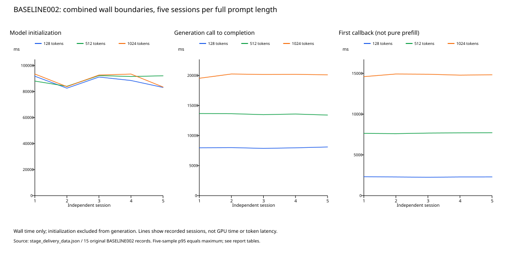
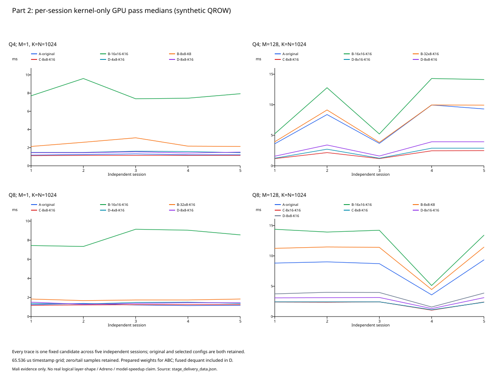
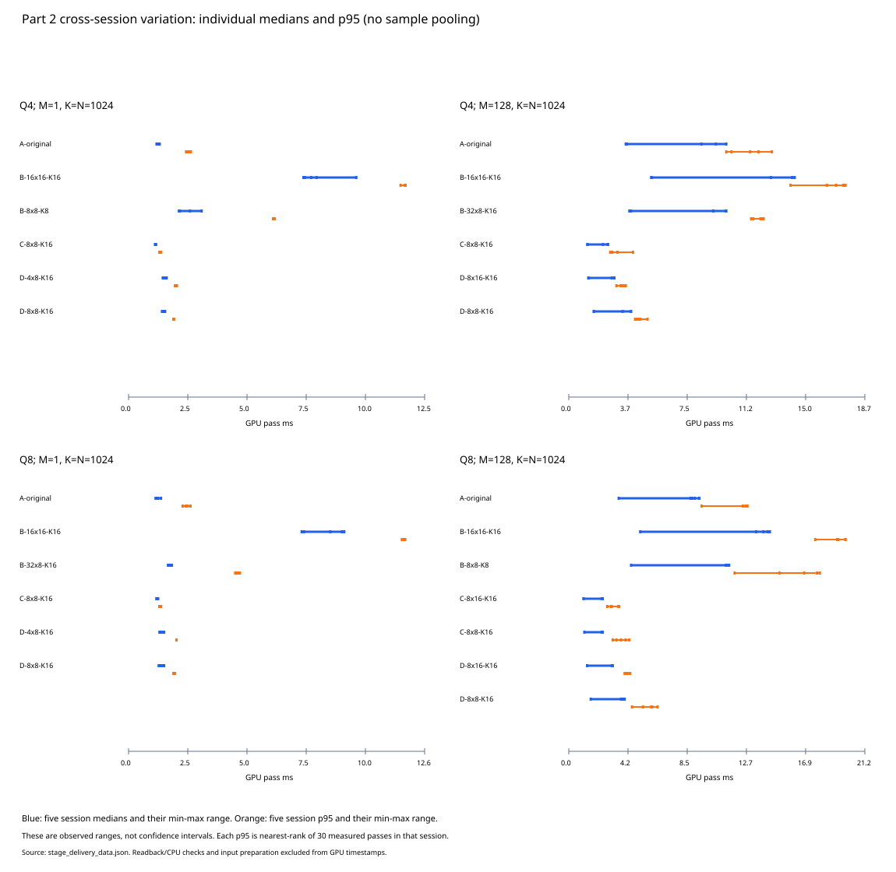

# 当前阶段交付报告：PARTIAL（部分完成）

截至2026-10-06，仅整理已归档实测和离线核验；本轮无手机、模型或 benchmark 运行。实验 JSON 的 COMPLETE/PASS 仅表示该实验内部验收，不表示整个原题完成。当前设备为 Mali，真实有效 decode/prefill layer shape 未确认，未宣称模型加速。

原题：[原始 assignment，3页](../assignment/webgpu_adreno_assignment.pdf)，SHA256 `dc02d42a5fdf521b75794ac641478cfe91ec7d9e165fa93a1c2e43b3ec63e9c3`。逐项原文、页码、mandatory/optional/示例区分与状态见[要求矩阵](../docs/assignment_requirements_matrix.md)。COMPLETE=该行明确范围已具备证据；PARTIAL=部分证据；BLOCKED=当前接口/有效证据无法取得；NOT_RUN=尚未执行。整体与两个 Part 都为 PARTIAL。

## 环境与范围

环境依据[环境记录](../docs/environment.md)：OnePlus PMB110 / Dimensity9500 / Mali-G1-Ultra MC12、Android16、Chrome154.0.8037.92 来自用户截图；JSON 的 reduced UA 不足以识别真实 OS/GPU，adapter 的空 device/description 保留。driver2.1.28733 是 chrome://gpu/ANGLE 元数据，不能当成已确认的 runtime WebGPU driver。模型为已校验 Gemma3n E2B Web .litertlm，tasks-genai0.10.29 固定；未修改算法。正式目标 Snapdragon/Adreno 尚未测。

[模型身份清单](../assets/models/model_manifest.json)：gemma-3n-E2B-it-int4-Web.litertlm，3,038,117,888 bytes，SHA256 `b6c8e1081ec80730f14473a5ece941b48da5d8e2a80c97c2963da153f3eff3d2`；这是本机文件身份，官方revision/publisher hash未独立确认，文件大小不是运行内存。runtime JS/WASM同为0.10.29，资源文件哈希见[runtime manifest](../src/baseline/runtime_manifest.json)。模型环境探测adapter与观察到的runtime device分别记录，runtime backend UNKNOWN；Part2自建device实际启用shader-f16与timestamp-query，完整limits见各raw，不以adapter支持代替device实际能力。

BASELINE002：纯文本，maxTokens2048为输入+输出总容量，topK40、temperature0.8、seed101、numResponses1。一页/新task/device只生成一次，0次生成 warm-up；tokenizer准备单独计时。stock cache/rewinding默认不改，OS/browser/driver缓存未清空。15会话均前台、无错误；主观无明显发热≠测温，充电/电量、VPN与 DevTools/flag 为各文件人工记录，非严格硬件控温。Part2五轮充电状态与电量分别记录，同样未测温；以各 raw 手工字段为准。

## Part 1：已测组合墙钟，不替代原题纯 phase/token 指标

完整 prompt 用模型实际 sizeInTokens 核对128/512/1024，正文120/504/1016；模板差值8计入完整输入。不能据此确认隐藏 BOS 或实际 prefill tensor 长度。各长度5个独立会话，非一次会话拆样；每组 nearest-rank p95 在n=5时等于最大值，尾部证据有限。首次 callback 不是纯 prefill；callback不等于token；生成结束 promise 与 GPU drain 分别记录。

|完整输入tokens|会话数|初始化median/p95(s)|生成调用至完成median/p95(s)|首callback median/p95(s)|drain median/p95(ms)|
|---|---|---|---|---|---|
|128|5|88.482 / 91.773|7.963 / 8.096|2.291 / 2.321|100.900 / 107.400|
|512|5|91.549 / 92.281|13.581 / 13.662|7.676 / 7.721|98.300 / 106.800|
|1024|5|92.673 / 93.478|20.167 / 20.246|14.834 / 14.928|94.800 / 101.600|

|tokens|轮|初始化s|生成s|首callback s|drain ms|
|---|---|---|---|---|---|
|128|1|91.773|7.963|2.321|107.400|
|128|2|82.591|7.998|2.289|100.900|
|128|3|91.162|7.862|2.253|97.200|
|128|4|88.482|7.958|2.291|103.700|
|128|5|83.152|8.096|2.293|100.600|
|512|1|88.035|13.662|7.641|98.000|
|512|2|84.032|13.640|7.607|106.800|
|512|3|92.281|13.480|7.676|98.300|
|512|4|91.549|13.581|7.707|106.200|
|512|5|92.103|13.412|7.721|96.800|
|1024|1|93.478|19.539|14.603|101.600|
|1024|2|83.766|20.246|14.928|93.400|
|1024|3|92.673|20.167|14.898|94.800|
|1024|4|93.433|20.186|14.788|93.500|
|1024|5|83.471|20.111|14.834|99.900|

限制：[固定runtime审查](../docs/remaining_metrics_feasibility.md)没有支持的真实生成IDs/count或独立prefill/decode入口。因此 tokens/s、真实 per-token latency、dispatch/token、纯phase继续 BLOCKED/UNAVAILABLE。[PROFILE002结构分析](../docs/profile002_shader_analysis.md)提供生成提交关联及算子源码分类，不以dispatch数推断耗时。PROFILE003/TIMING002重叠诊断不能产生独占kernel表或可加和breakdown；[TRACE001](../docs/trace001_availability.md)只发现已注册GPU内存源，未发现执行timeline源，算子关联UNKNOWN。瓶颈排名/硬件原因仍无充分依据。

## 分口径内存：不相加为物理GPU内存

15个BASELINE002的JS heap、逻辑buffer和texture分别报告。JS heap API值重复且粗粒度，不覆盖所有native/WASM；buffer为观察到的显式生命周期账面bytes；MEMORY001离线补齐全部7500个texture（每会话500，六格式，覆盖100%），按mip/layer/sample核算payload，不含上传row padding或驱动开销。累计创建量不是活跃峰值；显式destroy账面变化不是物理释放/泄漏证明。

|tokens(每组5会话)|快照|JS reported used bytes范围|buffer logical live bytes范围|texture live payload bytes范围|
|---|---|---|---|---|
|128|AFTER_INIT|10000000|83077648|1707566808|
|128|BEFORE_GENERATION|10000000|83077648|1707566808|
|128|AFTER_GENERATION|10000000|83509264|1707566808|
|128|AFTER_DRAIN|10000000|83509264|1707566808|
|128|AFTER_TASK_CLOSE|10000000|16501424|0|
|512|AFTER_INIT|10000000|83077648|1707566808|
|512|BEFORE_GENERATION|10000000|83077648|1707566808|
|512|AFTER_GENERATION|10000000|83536240|1707566808|
|512|AFTER_DRAIN|10000000|83536240|1707566808|
|512|AFTER_TASK_CLOSE|10000000|16528400|0|
|1024|AFTER_INIT|10000000|83077648|1707566808|
|1024|BEFORE_GENERATION|10000000|83077648|1707566808|
|1024|AFTER_GENERATION|10000000|83482288|1707566808|
|1024|AFTER_DRAIN|10000000|83482288|1707566808|
|1024|AFTER_TASK_CLOSE|10000000|16474448|0|

|tokens|texture累计创建bytes范围|显式事件活跃payload峰值bytes范围|峰值阶段|覆盖|
|---|---|---|---|---|
|128|1707579096–1707579096|1707566808–1707566808|MODEL_INIT|2500/2500|
|512|1707579096–1707579096|1707566808–1707566808|MODEL_INIT|2500/2500|
|1024|1707579096–1707579096|1707566808–1707566808|MODEL_INIT|2500/2500|

初始化前buffer/texture快照UNAVAILABLE：observer尚未安装，不猜为0。完整逐会话及未覆盖范围见[MEMORY001](../docs/memory001_texture_accounting.md)。物理GPU驻留、native/WASM整体内存未取得。

MEMORY002 v1保留PARTIAL；v2仅一次128-token协议pilot，四必需阶段覆盖、另保留生成前快照。初始化后台切换5.606s警告；renderer页面归属UNKNOWN，browser/GPU角色逐快照核验。下面单位KiB，同PID同start-tick的差值，非模型独占内存；PSS不是物理GPU内存，RSS跨进程相加会重复共享页。生成窗口归属仅在观测时钟不确定范围约28.975ms和协议假设下成立；稀疏快照不是连续峰值。

|阶段|进程范围|PSS KiB|ΔPSS vs idle|RSS KiB|ΔRSS vs idle|
|---|---|---|---|---|---|
|PAGE_IDLE|BROWSER_MAIN|249919|0|429182|0|
|PAGE_IDLE|GPU|162986|0|304373|0|
|AFTER_INIT|BROWSER_MAIN|239975|-9944|423966|-5216|
|AFTER_INIT|GPU|2163859|2000873|2446557|2142184|
|BEFORE_GENERATION|BROWSER_MAIN|230188|-19731|414202|-14980|
|BEFORE_GENERATION|GPU|2158928|1995942|2441669|2137296|
|GENERATION|BROWSER_MAIN|229729|-20190|413946|-15236|
|GENERATION|GPU|2693656|2530670|2976429|2672056|
|AFTER_DRAIN|BROWSER_MAIN|229605|-20314|413822|-15360|
|AFTER_DRAIN|GPU|2167082|2004096|2449841|2145468|

证据：[v2报告](../docs/memory002_v2_pilot_results.md)。系统原文与v2页面JSON仅本地忽略保存；公开派生表及哈希可审查。设备RSS/PSS五次独立重复 NOT_RUN，原题memory总体PARTIAL，未关闭重复要求。

## Part 2：合成QROW FP16 A–D与五轮复验

契约[PART2-QROW-v1](../docs/part2_compute_contract.md)：row-major A[M,K]×B[K,N]，Q4/Q8无符号codes，逐K行packed u32、低位优先、沿K group32，FP16 scale、u32 zero-point；dequant=(q−zp)×scale，再按契约转换f16。这是合成QROW实验格式，不是Gemma原生格式/真实权重。FP16 activation、权重数值、递增K的显式f16 fma累加，f16结果以f32 carrier存储。FP16 accumulation probe2048（FP32为2050）通过；不是硬件逐位/指令证明。

A naive；B shared-memory tiled；C tiled vec4/packed-u32加载；D fused Q4/Q8 unpack+dequant+GEMM。C不是M=1 specialized，packed FP16解包不是INT4反量化。实际数学性能shape是代表性M=1/128,K=N=1024；GEMM004的M8/K1536/N2048仅已证明执行/padded shape，不能充当真实有效decode/prefill layer shape。无任意batch/head折叠。

每独立Part2会话重新页面与device、重编译pipeline及准备；固定A、原B/C/D与冻结选定配置，同配置去重。每候选10warm-up+30measured，seed与循环平衡顺序冻结，不根据复验改选；五会话总5000计时样本（含warm-up），逐轮保持原样，未pool为一个median。kernel-only：单pass单dispatch，timestampWrites/BigInt差值；串行GPU完成、全量读回/在线校验后下一样本。准备/上传/编译/分配/reference/readback/CPU校验在GPU timestamp外，submit-to-completion墙钟单独保存。串行读回会改变运行状态，GPU pass包含调度等成本。

|Q格式|M|原B→选B|原C→选C|原D→选D|
|---|---|---|---|---|
|Q4|1|16×16-K16→8x8-K8|8×8-K16→8x8-K16|8×8-K16→4x8-K16|
|Q4|128|16×16-K16→32x8-K16|8×8-K16→8x8-K16|8×8-K16→8x16-K16|
|Q8|1|16×16-K16→32x8-K16|8×8-K16→8x8-K16|8×8-K16→4x8-K16|
|Q8|128|16×16-K16→8x8-K8|8×8-K16→8x16-K16|8×8-K16→8x16-K16|

### Q4, M=1, K=N=1024：逐轮绝对耗时与同轮比值

|候选|轮|median ms|nearest-rank p95 ms|名义GFLOP/s|A/候选|比值分辨率标记|本版本原配置/候选|零值数|max abs err vs FP32|
|---|---|---|---|---|---|---|---|---|---|
|A-original|1|1.179648|2.424832|1.778|1.0000|WITHIN_ONE_GRID|1.0000|0|0.018066406|
|A-original|2|1.245184|2.621440|1.684|1.0000|WITHIN_ONE_GRID|1.0000|0|0.018066406|
|A-original|3|1.310720|2.621440|1.600|1.0000|WITHIN_ONE_GRID|1.0000|0|0.018066406|
|A-original|4|1.212416|2.555904|1.730|1.0000|WITHIN_ONE_GRID|1.0000|0|0.018066406|
|A-original|5|1.212416|2.490368|1.730|1.0000|WITHIN_ONE_GRID|1.0000|0|0.018066406|
|B-16x16-K16|1|7.700480|11.665408|0.272|0.1532|RESOLVED_IN_THIS_SESSION|1.0000|0|0.018066406|
|B-16x16-K16|2|9.601024|11.665408|0.218|0.1297|RESOLVED_IN_THIS_SESSION|1.0000|0|0.018066406|
|B-16x16-K16|3|7.372800|11.468800|0.284|0.1778|RESOLVED_IN_THIS_SESSION|1.0000|0|0.018066406|
|B-16x16-K16|4|7.438336|11.665408|0.282|0.1630|RESOLVED_IN_THIS_SESSION|1.0000|0|0.018066406|
|B-16x16-K16|5|7.929856|11.665408|0.264|0.1529|RESOLVED_IN_THIS_SESSION|1.0000|0|0.018066406|
|B-8x8-K8|1|2.129920|6.160384|0.985|0.5538|RESOLVED_IN_THIS_SESSION|3.6154|0|0.018066406|
|B-8x8-K8|2|2.588672|6.094848|0.810|0.4810|RESOLVED_IN_THIS_SESSION|3.7089|0|0.018066406|
|B-8x8-K8|3|3.080192|6.094848|0.681|0.4255|RESOLVED_IN_THIS_SESSION|2.3936|0|0.018066406|
|B-8x8-K8|4|2.162688|6.160384|0.970|0.5606|RESOLVED_IN_THIS_SESSION|3.4394|0|0.018066406|
|B-8x8-K8|5|2.129920|6.094848|0.985|0.5692|RESOLVED_IN_THIS_SESSION|3.7231|0|0.018066406|
|C-8x8-K16|1|1.114112|1.310720|1.882|1.0588|WITHIN_ONE_GRID|1.0000|0|0.018066406|
|C-8x8-K16|2|1.146880|1.376256|1.829|1.0857|RESOLVED_IN_THIS_SESSION|1.0000|0|0.018066406|
|C-8x8-K16|3|1.146880|1.310720|1.829|1.1429|RESOLVED_IN_THIS_SESSION|1.0000|0|0.018066406|
|C-8x8-K16|4|1.146880|1.310720|1.829|1.0571|WITHIN_ONE_GRID|1.0000|0|0.018066406|
|C-8x8-K16|5|1.146880|1.310720|1.829|1.0571|WITHIN_ONE_GRID|1.0000|0|0.018066406|
|D-4x8-K16|1|1.474560|1.966080|1.422|0.8000|RESOLVED_IN_THIS_SESSION|0.9778|0|0.018066406|
|D-4x8-K16|2|1.474560|2.031616|1.422|0.8444|RESOLVED_IN_THIS_SESSION|0.9778|0|0.018066406|
|D-4x8-K16|3|1.605632|1.966080|1.306|0.8163|RESOLVED_IN_THIS_SESSION|0.9592|0|0.018066406|
|D-4x8-K16|4|1.572864|1.966080|1.333|0.7708|RESOLVED_IN_THIS_SESSION|0.8958|0|0.018066406|
|D-4x8-K16|5|1.441792|2.031616|1.455|0.8409|RESOLVED_IN_THIS_SESSION|1.0455|0|0.018066406|
|D-8x8-K16|1|1.441792|1.900544|1.455|0.8182|RESOLVED_IN_THIS_SESSION|1.0000|0|0.018066406|
|D-8x8-K16|2|1.441792|1.900544|1.455|0.8636|RESOLVED_IN_THIS_SESSION|1.0000|0|0.018066406|
|D-8x8-K16|3|1.540096|1.900544|1.362|0.8511|RESOLVED_IN_THIS_SESSION|1.0000|0|0.018066406|
|D-8x8-K16|4|1.409024|1.900544|1.488|0.8605|RESOLVED_IN_THIS_SESSION|1.0000|0|0.018066406|
|D-8x8-K16|5|1.507328|1.900544|1.391|0.8043|RESOLVED_IN_THIS_SESSION|1.0000|0|0.018066406|

### Q4, M=128, K=N=1024：逐轮绝对耗时与同轮比值

|候选|轮|median ms|nearest-rank p95 ms|名义GFLOP/s|A/候选|比值分辨率标记|本版本原配置/候选|零值数|max abs err vs FP32|
|---|---|---|---|---|---|---|---|---|---|
|A-original|1|3.604480|11.993088|74.473|1.0000|WITHIN_ONE_GRID|1.0000|0|0.030761719|
|A-original|2|8.388608|10.289152|32.000|1.0000|WITHIN_ONE_GRID|1.0000|0|0.030761719|
|A-original|3|3.670016|9.961472|73.143|1.0000|WITHIN_ONE_GRID|1.0000|0|0.030761719|
|A-original|4|9.961472|11.468800|26.947|1.0000|WITHIN_ONE_GRID|1.0000|0|0.030761719|
|A-original|5|9.306112|12.845056|28.845|1.0000|WITHIN_ONE_GRID|1.0000|0|0.030761719|
|B-16x16-K16|1|5.242880|14.024704|51.200|0.6875|RESOLVED_IN_THIS_SESSION|1.0000|0|0.030761719|
|B-16x16-K16|2|12.779520|16.318464|21.005|0.6564|RESOLVED_IN_THIS_SESSION|1.0000|0|0.030761719|
|B-16x16-K16|3|5.210112|16.908288|51.522|0.7044|RESOLVED_IN_THIS_SESSION|1.0000|0|0.030761719|
|B-16x16-K16|4|14.286848|17.498112|18.789|0.6972|RESOLVED_IN_THIS_SESSION|1.0000|0|0.030761719|
|B-16x16-K16|5|14.123008|17.367040|19.007|0.6589|RESOLVED_IN_THIS_SESSION|1.0000|0|0.030761719|
|B-32x8-K16|1|3.932160|11.665408|68.267|0.9167|RESOLVED_IN_THIS_SESSION|1.3333|0|0.030761719|
|B-32x8-K16|2|9.142272|12.320768|29.362|0.9176|RESOLVED_IN_THIS_SESSION|1.3978|0|0.030761719|
|B-32x8-K16|3|3.833856|11.534336|70.017|0.9573|RESOLVED_IN_THIS_SESSION|1.3590|0|0.030761719|
|B-32x8-K16|4|9.961472|12.124160|26.947|1.0000|WITHIN_ONE_GRID|1.4342|0|0.030761719|
|B-32x8-K16|5|9.928704|12.189696|27.036|0.9373|RESOLVED_IN_THIS_SESSION|1.4224|0|0.030761719|
|C-8x8-K16|1|1.179648|2.621440|227.556|3.0556|RESOLVED_IN_THIS_SESSION|1.0000|0|0.030761719|
|C-8x8-K16|2|2.162688|2.752512|124.121|3.8788|RESOLVED_IN_THIS_SESSION|1.0000|0|0.030761719|
|C-8x8-K16|3|1.179648|4.063232|227.556|3.1111|RESOLVED_IN_THIS_SESSION|1.0000|0|0.030761719|
|C-8x8-K16|4|2.457600|3.080192|109.227|4.0533|RESOLVED_IN_THIS_SESSION|1.0000|0|0.030761719|
|C-8x8-K16|5|2.490368|3.080192|107.789|3.7368|RESOLVED_IN_THIS_SESSION|1.0000|0|0.030761719|
|D-8x16-K16|1|1.245184|3.014656|215.579|2.8947|RESOLVED_IN_THIS_SESSION|1.2632|0|0.030761719|
|D-8x16-K16|2|2.719744|3.538944|98.699|3.0843|RESOLVED_IN_THIS_SESSION|1.2530|0|0.030761719|
|D-8x16-K16|3|1.245184|3.276800|215.579|2.9474|RESOLVED_IN_THIS_SESSION|1.2895|0|0.030761719|
|D-8x16-K16|4|2.883584|3.604480|93.091|3.4545|RESOLVED_IN_THIS_SESSION|1.3636|0|0.030761719|
|D-8x16-K16|5|2.883584|3.407872|93.091|3.2273|RESOLVED_IN_THIS_SESSION|1.3636|0|0.030761719|
|D-8x8-K16|1|1.572864|4.521984|170.667|2.2917|RESOLVED_IN_THIS_SESSION|1.0000|0|0.030761719|
|D-8x8-K16|2|3.407872|4.325376|78.769|2.4615|RESOLVED_IN_THIS_SESSION|1.0000|0|0.030761719|
|D-8x8-K16|3|1.605632|4.194304|167.184|2.2857|RESOLVED_IN_THIS_SESSION|1.0000|0|0.030761719|
|D-8x8-K16|4|3.932160|4.456448|68.267|2.5333|RESOLVED_IN_THIS_SESSION|1.0000|0|0.030761719|
|D-8x8-K16|5|3.932160|4.980736|68.267|2.3667|RESOLVED_IN_THIS_SESSION|1.0000|0|0.030761719|

### Q8, M=1, K=N=1024：逐轮绝对耗时与同轮比值

|候选|轮|median ms|nearest-rank p95 ms|名义GFLOP/s|A/候选|比值分辨率标记|本版本原配置/候选|零值数|max abs err vs FP32|
|---|---|---|---|---|---|---|---|---|---|
|A-original|1|1.245184|2.621440|1.684|1.0000|WITHIN_ONE_GRID|1.0000|0|0.017425537|
|A-original|2|1.376256|2.621440|1.524|1.0000|WITHIN_ONE_GRID|1.0000|0|0.017425537|
|A-original|3|1.212416|2.490368|1.730|1.0000|WITHIN_ONE_GRID|1.0000|0|0.017425537|
|A-original|4|1.146880|2.424832|1.829|1.0000|WITHIN_ONE_GRID|1.0000|0|0.017425537|
|A-original|5|1.179648|2.293760|1.778|1.0000|WITHIN_ONE_GRID|1.0000|0|0.017425537|
|B-16x16-K16|1|7.438336|11.665408|0.282|0.1674|RESOLVED_IN_THIS_SESSION|1.0000|0|0.017425537|
|B-16x16-K16|2|7.340032|11.730944|0.286|0.1875|RESOLVED_IN_THIS_SESSION|1.0000|0|0.017425537|
|B-16x16-K16|3|9.142272|11.599872|0.229|0.1326|RESOLVED_IN_THIS_SESSION|1.0000|0|0.017425537|
|B-16x16-K16|4|9.043968|11.599872|0.232|0.1268|RESOLVED_IN_THIS_SESSION|1.0000|0|0.017425537|
|B-16x16-K16|5|8.552448|11.599872|0.245|0.1379|RESOLVED_IN_THIS_SESSION|1.0000|0|0.017425537|
|B-32x8-K16|1|1.835008|4.718592|1.143|0.6786|RESOLVED_IN_THIS_SESSION|4.0536|0|0.017425537|
|B-32x8-K16|2|1.671168|4.587520|1.255|0.8235|RESOLVED_IN_THIS_SESSION|4.3922|0|0.017425537|
|B-32x8-K16|3|1.736704|4.653056|1.208|0.6981|RESOLVED_IN_THIS_SESSION|5.2642|0|0.017425537|
|B-32x8-K16|4|1.736704|4.587520|1.208|0.6604|RESOLVED_IN_THIS_SESSION|5.2075|0|0.017425537|
|B-32x8-K16|5|1.835008|4.521984|1.143|0.6429|RESOLVED_IN_THIS_SESSION|4.6607|0|0.017425537|
|C-8x8-K16|1|1.179648|1.310720|1.778|1.0556|WITHIN_ONE_GRID|1.0000|0|0.017425537|
|C-8x8-K16|2|1.212416|1.310720|1.730|1.1351|RESOLVED_IN_THIS_SESSION|1.0000|0|0.017425537|
|C-8x8-K16|3|1.245184|1.310720|1.684|0.9737|WITHIN_ONE_GRID|1.0000|0|0.017425537|
|C-8x8-K16|4|1.245184|1.376256|1.684|0.9211|RESOLVED_IN_THIS_SESSION|1.0000|0|0.017425537|
|C-8x8-K16|5|1.245184|1.376256|1.684|0.9474|WITHIN_ONE_GRID|1.0000|0|0.017425537|
|D-4x8-K16|1|1.376256|2.031616|1.524|0.9048|RESOLVED_IN_THIS_SESSION|1.0952|0|0.017425537|
|D-4x8-K16|2|1.310720|2.031616|1.600|1.0500|WITHIN_ONE_GRID|0.9750|0|0.017425537|
|D-4x8-K16|3|1.474560|2.031616|1.422|0.8222|RESOLVED_IN_THIS_SESSION|0.9333|0|0.017425537|
|D-4x8-K16|4|1.507328|2.031616|1.391|0.7609|RESOLVED_IN_THIS_SESSION|0.9565|0|0.017425537|
|D-4x8-K16|5|1.376256|2.031616|1.524|0.8571|RESOLVED_IN_THIS_SESSION|1.0476|0|0.017425537|
|D-8x8-K16|1|1.507328|1.966080|1.391|0.8261|RESOLVED_IN_THIS_SESSION|1.0000|0|0.017425537|
|D-8x8-K16|2|1.277952|1.900544|1.641|1.0769|RESOLVED_IN_THIS_SESSION|1.0000|0|0.017425537|
|D-8x8-K16|3|1.376256|1.966080|1.524|0.8810|RESOLVED_IN_THIS_SESSION|1.0000|0|0.017425537|
|D-8x8-K16|4|1.441792|1.966080|1.455|0.7955|RESOLVED_IN_THIS_SESSION|1.0000|0|0.017425537|
|D-8x8-K16|5|1.441792|1.966080|1.455|0.8182|RESOLVED_IN_THIS_SESSION|1.0000|0|0.017425537|

### Q8, M=128, K=N=1024：逐轮绝对耗时与同轮比值

|候选|轮|median ms|nearest-rank p95 ms|名义GFLOP/s|A/候选|比值分辨率标记|本版本原配置/候选|零值数|max abs err vs FP32|
|---|---|---|---|---|---|---|---|---|---|
|A-original|1|8.814592|12.779520|30.454|1.0000|WITHIN_ONE_GRID|1.0000|0|0.03326416|
|A-original|2|9.011200|12.451840|29.789|1.0000|WITHIN_ONE_GRID|1.0000|0|0.03326416|
|A-original|3|8.716288|12.648448|30.797|1.0000|WITHIN_ONE_GRID|1.0000|0|0.03326416|
|A-original|4|3.571712|9.502720|75.156|1.0000|WITHIN_ONE_GRID|1.0000|0|0.03326416|
|A-original|5|9.338880|12.713984|28.744|1.0000|WITHIN_ONE_GRID|1.0000|0|0.03326416|
|B-16x16-K16|1|14.385152|19.791872|18.661|0.6128|RESOLVED_IN_THIS_SESSION|1.0000|0|0.03326416|
|B-16x16-K16|2|13.926400|19.791872|19.275|0.6471|RESOLVED_IN_THIS_SESSION|1.0000|0|0.03326416|
|B-16x16-K16|3|14.221312|19.202048|18.876|0.6129|RESOLVED_IN_THIS_SESSION|1.0000|0|0.03326416|
|B-16x16-K16|4|5.111808|17.629184|52.513|0.6987|RESOLVED_IN_THIS_SESSION|1.0000|0|0.03326416|
|B-16x16-K16|5|13.402112|19.267584|20.029|0.6968|RESOLVED_IN_THIS_SESSION|1.0000|0|0.03326416|
|B-8x8-K8|1|11.239424|16.842752|23.883|0.7843|RESOLVED_IN_THIS_SESSION|1.2799|0|0.03326416|
|B-8x8-K8|2|11.468800|17.760256|23.406|0.7857|RESOLVED_IN_THIS_SESSION|1.2143|0|0.03326416|
|B-8x8-K8|3|11.403264|15.073280|23.540|0.7644|RESOLVED_IN_THIS_SESSION|1.2471|0|0.03326416|
|B-8x8-K8|4|4.456448|11.862016|60.235|0.8015|RESOLVED_IN_THIS_SESSION|1.1471|0|0.03326416|
|B-8x8-K8|5|11.436032|17.956864|23.473|0.8166|RESOLVED_IN_THIS_SESSION|1.1719|0|0.03326416|
|C-8x16-K16|1|2.392064|3.604480|112.219|3.6849|RESOLVED_IN_THIS_SESSION|1.0137|0|0.03326416|
|C-8x16-K16|2|2.359296|3.080192|113.778|3.8194|RESOLVED_IN_THIS_SESSION|1.0278|0|0.03326416|
|C-8x16-K16|3|2.424832|3.538944|110.703|3.5946|RESOLVED_IN_THIS_SESSION|1.0000|0|0.03326416|
|C-8x16-K16|4|1.048576|2.752512|256.000|3.4062|RESOLVED_IN_THIS_SESSION|1.0625|0|0.03326416|
|C-8x16-K16|5|2.392064|3.014656|112.219|3.9041|RESOLVED_IN_THIS_SESSION|0.9863|0|0.03326416|
|C-8x8-K16|1|2.424832|3.735552|110.703|3.6351|RESOLVED_IN_THIS_SESSION|1.0000|0|0.03326416|
|C-8x8-K16|2|2.424832|4.063232|110.703|3.7162|RESOLVED_IN_THIS_SESSION|1.0000|0|0.03326416|
|C-8x8-K16|3|2.424832|3.407872|110.703|3.5946|RESOLVED_IN_THIS_SESSION|1.0000|0|0.03326416|
|C-8x8-K16|4|1.114112|3.145728|240.941|3.2059|RESOLVED_IN_THIS_SESSION|1.0000|0|0.03326416|
|C-8x8-K16|5|2.359296|4.325376|113.778|3.9583|RESOLVED_IN_THIS_SESSION|1.0000|0|0.03326416|
|D-8x16-K16|1|3.080192|4.128768|87.149|2.8617|RESOLVED_IN_THIS_SESSION|1.2128|0|0.03326416|
|D-8x16-K16|2|3.112960|4.194304|86.232|2.8947|RESOLVED_IN_THIS_SESSION|1.2842|0|0.03326416|
|D-8x16-K16|3|3.145728|4.194304|85.333|2.7708|RESOLVED_IN_THIS_SESSION|1.2604|0|0.03326416|
|D-8x16-K16|4|1.310720|3.997696|204.800|2.7250|RESOLVED_IN_THIS_SESSION|1.2000|0|0.03326416|
|D-8x16-K16|5|3.112960|4.390912|86.232|3.0000|RESOLVED_IN_THIS_SESSION|1.2421|0|0.03326416|
|D-8x8-K16|1|3.735552|5.898240|71.860|2.3596|RESOLVED_IN_THIS_SESSION|1.0000|0|0.03326416|
|D-8x8-K16|2|3.997696|5.963776|67.148|2.2541|RESOLVED_IN_THIS_SESSION|1.0000|0|0.03326416|
|D-8x8-K16|3|3.964928|6.356992|67.702|2.1983|RESOLVED_IN_THIS_SESSION|1.0000|0|0.03326416|
|D-8x8-K16|4|1.572864|4.521984|170.667|2.2708|RESOLVED_IN_THIS_SESSION|1.0000|0|0.03326416|
|D-8x8-K16|5|3.866624|5.308416|69.424|2.4153|RESOLVED_IN_THIS_SESSION|1.0000|0|0.03326416|

各行比值只使用同一会话median；>1表示分母较快，<1表示较慢。误差列为该会话该候选采样记录（含warm-up）在线全量检查的max absolute error vs FP32，不是独立重建的大型actual。原始时间戳保留零值与长尾，30measured nearest-rank p95为排序第29个；已观测网格65.536µs，median中点可有半网格。WITHIN_ONE_GRID不支持精确小幅收益。图表为五会话的逐会话统计/范围，不是pool后统计或置信区间。名义2MNK FLOPs下有效GFLOP/s写入派生JSON，仅是pass级算术计数约定，D额外解包指令不计其中；非硬件峰值利用率。实际DRAM GB/s未测，原题effective GB/s统一计数口径未完整报告，不将nominal accesses冒充DRAM测量。

|组合|版本|原/选比值五轮范围|五轮方向（按网格）|
|---|---|---|---|
|4:1|B|2.3936–3.7231|SELECTED_FASTER, SELECTED_FASTER, SELECTED_FASTER, SELECTED_FASTER, SELECTED_FASTER|
|4:1|C|1.0000–1.0000|INDISTINGUISHABLE, INDISTINGUISHABLE, INDISTINGUISHABLE, INDISTINGUISHABLE, INDISTINGUISHABLE|
|4:1|D|0.8958–1.0455|INDISTINGUISHABLE, INDISTINGUISHABLE, INDISTINGUISHABLE, SELECTED_SLOWER, INDISTINGUISHABLE|
|4:128|B|1.3333–1.4342|SELECTED_FASTER, SELECTED_FASTER, SELECTED_FASTER, SELECTED_FASTER, SELECTED_FASTER|
|4:128|C|1.0000–1.0000|INDISTINGUISHABLE, INDISTINGUISHABLE, INDISTINGUISHABLE, INDISTINGUISHABLE, INDISTINGUISHABLE|
|4:128|D|1.2530–1.3636|SELECTED_FASTER, SELECTED_FASTER, SELECTED_FASTER, SELECTED_FASTER, SELECTED_FASTER|
|8:1|B|4.0536–5.2642|SELECTED_FASTER, SELECTED_FASTER, SELECTED_FASTER, SELECTED_FASTER, SELECTED_FASTER|
|8:1|C|1.0000–1.0000|INDISTINGUISHABLE, INDISTINGUISHABLE, INDISTINGUISHABLE, INDISTINGUISHABLE, INDISTINGUISHABLE|
|8:1|D|0.9333–1.0952|SELECTED_FASTER, INDISTINGUISHABLE, SELECTED_SLOWER, INDISTINGUISHABLE, INDISTINGUISHABLE|
|8:128|B|1.1471–1.2799|SELECTED_FASTER, SELECTED_FASTER, SELECTED_FASTER, SELECTED_FASTER, SELECTED_FASTER|
|8:128|C|0.9863–1.0625|INDISTINGUISHABLE, INDISTINGUISHABLE, INDISTINGUISHABLE, INDISTINGUISHABLE, INDISTINGUISHABLE|
|8:128|D|1.2000–1.2842|SELECTED_FASTER, SELECTED_FASTER, SELECTED_FASTER, SELECTED_FASTER, SELECTED_FASTER|

观察：选定B在四组合相对原B五轮均较快，但不是必然快于A；M=1的B仍较慢。选定D在M128相对原D五轮较快；M1的Q4 D出现较慢、Q8 D有方向反转，其余差异多在一个网格内，保留不确定性。Q8 M1 A/C也存在方向变化，不能声称稳定小幅收益。C配置变化的Q8 M128均为网格内无法区分。形状/加载/共享内存/barrier是源码事实；缓存、occupancy、带宽或调度只是待验证解释。vec4语法不证明硬件向量指令。

## 权重准备成本：两个口径不得混用

五轮复验仅prepared-input kernel-only。ABC已完成CPU反量化与C布局准备，D在pass内反量化，实际输入资源不同。一次准备成本/逻辑资源记录在原始preprocessing中，不隐藏为kernel收益。先前独立Q4/Q8 A–D pilot另有完整路径墙钟：每样本确实从共同packed输入重做CPU反量化、布局转换、必要上传到最终GPU完成，排除reference/输出校验；不是两个median简单相加，也不是把CPU ms加到GPU ns称GPU时间。完整路径仅一次pilot，不是五轮复验结果。

|独立历史pilot|M|版本|完整路径墙钟median ms|p95 ms|
|---|---|---|---|---|
|Q4|1|A|68.200|102.500|
|Q4|1|B|77.850|106.500|
|Q4|1|C|71.450|98.500|
|Q4|1|D|3.800|5.600|
|Q4|128|A|90.800|111.500|
|Q4|128|B|86.000|113.300|
|Q4|128|C|79.450|97.600|
|Q4|128|D|7.450|9.200|
|Q8|1|A|69.650|86.500|
|Q8|1|B|76.600|82.800|
|Q8|1|C|69.900|74.600|
|Q8|1|D|3.900|4.700|
|Q8|128|A|77.250|85.800|
|Q8|128|B|81.200|88.500|
|Q8|128|C|70.900|83.500|
|Q8|128|D|6.450|8.500|

Q4 pilot中D的kernel-only慢于C，但在每次CPU准备+转换+必要上传完整路径更快；这不适用于静态权重预处理一次后反复复用，也不等于模型加速。减少反量化中间矩阵只是逻辑buffer分配减少，不是实测物理GPU内存节省。不得使用历史pilot median作为五轮同轮比值分母，跨Q4/Q8会话差异不作受控因果结论。

## 正确性、证据索引与复现

运行前固定种子/两层reference/显式FP32 oracle与阈值；未因失败放宽。五轮全部候选通过在线全量输出和非有限值检查，小用例/FP16 probe保留完整数组；离线独立核验232985个导出小用例输出、5000时间戳与冻结顺序。大型actual数组未全量导出，离线不能声称重建所有大型actual；其正确性依据在线全量摘要及可复算的导出reference记录。

[阶段派生数据与证据哈希](../results/analysis/stage_delivery_data.json)；[BASELINE002汇总](../results/analysis/baseline002_summary.json)；[Part2五轮汇总](../results/analysis/part2_repeat_summary.json)；[texture逐会话核算](../results/analysis/memory001_texture_payload.json)；[v2公开核验](../results/analysis/memory002_v2_pilot_verification.json)；[TRACE001核验](../results/analysis/trace001_availability.json)。全部历史raw链接可通过阶段数据evidence列表和[历史SHA256清单](../results/analysis/raw_sha256_manifest.json)定位。PROFILE原始与[真实执行shape证据](../docs/gemm004_shape_proof.md)在原有文档中保留；有效逻辑shape仍未知。

公开仓库包含既有原始实验JSON与核验脚本；模型weights、本地固定runtime资源、node_modules、邮件updates、原始adb/DevTools/Perfetto清单与MEMORY002 v2原始页面JSON不发布。私有输入哈希公开，相关核验只能在保留原文的本机完整复现；不能声称干净clone拥有私有原文。模型需官方授权后手动准备，按model_manifest校验文件名/bytes/SHA256。

电脑离线重建（本轮已执行，不访问手机）：`python scripts/build_stage_report.py`；完整texture核验：`python scripts/verify_memory001.py`；私有证据核验（需本地原文）：`python scripts/verify_memory002_v2_pilot.py`、`python scripts/verify_trace001.py`。图表：使用含ReportLab的Python环境运行`python scripts/plot_stage_report.py`（普通Python若缺该库，先`python -m pip install reportlab`；本轮使用已有bundled库）。图表只读取阶段派生JSON，SVG为可导出静态原图。正式文档/图表一致性检查：`python scripts/check_stage_delivery.py`。电脑检查不等于新的GPU验收。

手机复现入口（说明用，本轮未运行）：从项目根目录`python -m http.server 8000 --bind 127.0.0.1`；USB授权后`& "C:\Tools\platform-tools\platform-tools\adb.exe" reverse tcp:8000 tcp:8000`。BASELINE002：`http://localhost:8000/src/baseline/sessions.html?v=baseline-session-v1`（每长度五新会话）；Part2：`http://localhost:8000/src/benchmark/part2_repeat.html?v=repeat-v1`（五新页面/device，固定候选）；[全部步骤与预算](../docs/part2_repeat_plan.md)。memory002协议另需`serve_memory002.py`和私有系统采样回执，不用普通server替代；不在此安排新采集。

当前交付是可复现的部分成果与明确缺口。下一阶段是否取得Adreno、真实有效layer shape或可验证native token/phase入口须单独决定；不自动追加实验、不扩大profiler或重做相同时间戳诊断。

## 本报告直接使用的公开原始证据索引

|原始文件（字节不变）|SHA256|核验范围|
|---|---|---|
|[BASELINE002-L1024-R1-2026-10-06T07-28-08-096Z.json](../results/raw/BASELINE002-L1024-R1-2026-10-06T07-28-08-096Z.json)|4ae4001e7eed0f6e1b865e4a481d466eceb8a1855ec6493eea97d8e9e95654bb|full prompt/recorded walls/resource ledger;not native token sequence|
|[BASELINE002-L1024-R2-2026-10-06T07-37-31-596Z.json](../results/raw/BASELINE002-L1024-R2-2026-10-06T07-37-31-596Z.json)|0fc14e964873b71d385ce62c1ba3010a2fb7c9b7fdb97339eaa4aa620a3c54b8|full prompt/recorded walls/resource ledger;not native token sequence|
|[BASELINE002-L1024-R3-2026-10-06T07-46-43-691Z.json](../results/raw/BASELINE002-L1024-R3-2026-10-06T07-46-43-691Z.json)|e7407b47357d1ea4c5d43cb279cc2edfad6631f1fe3efd171b5c023856584abd|full prompt/recorded walls/resource ledger;not native token sequence|
|[BASELINE002-L1024-R4-2026-10-06T08-02-23-026Z.json](../results/raw/BASELINE002-L1024-R4-2026-10-06T08-02-23-026Z.json)|95825df69b6b464c20c9b06d0d38958884f02143a8fc4e3575d0b8a517e61a03|full prompt/recorded walls/resource ledger;not native token sequence|
|[BASELINE002-L1024-R5-2026-10-06T08-14-18-851Z.json](../results/raw/BASELINE002-L1024-R5-2026-10-06T08-14-18-851Z.json)|f9de79fb4c6d416b159cc42ad075a7ac91d1de94b4bd6cfb0cd827e7b0531236|full prompt/recorded walls/resource ledger;not native token sequence|
|[BASELINE002-L128-R1-2026-10-06T07-19-26-784Z.json](../results/raw/BASELINE002-L128-R1-2026-10-06T07-19-26-784Z.json)|8fd3d0c51534493d6da61a1de78d0e91efcdf4c9ba2ce49de4afdfd916c50d4d|full prompt/recorded walls/resource ledger;not native token sequence|
|[BASELINE002-L128-R2-2026-10-06T07-41-20-289Z.json](../results/raw/BASELINE002-L128-R2-2026-10-06T07-41-20-289Z.json)|0fcc12110e79482ad6a0fbef3e7a77084c16484ca7cef2a612e238d9e62657f8|full prompt/recorded walls/resource ledger;not native token sequence|
|[BASELINE002-L128-R3-2026-10-06T07-51-45-180Z.json](../results/raw/BASELINE002-L128-R3-2026-10-06T07-51-45-180Z.json)|a715dd71687bcf87b688a8068d39381d8085713645f1537640be59747509022c|full prompt/recorded walls/resource ledger;not native token sequence|
|[BASELINE002-L128-R4-2026-10-06T07-59-17-219Z.json](../results/raw/BASELINE002-L128-R4-2026-10-06T07-59-17-219Z.json)|41533244d4132115b0d0667422680816bb2cb9b57f4ba17be9c29579caea983b|full prompt/recorded walls/resource ledger;not native token sequence|
|[BASELINE002-L128-R5-2026-10-06T08-10-57-422Z.json](../results/raw/BASELINE002-L128-R5-2026-10-06T08-10-57-422Z.json)|557a8868824f653262c0c2153fb2591907fa426402d1a969359cb966d43c5cae|full prompt/recorded walls/resource ledger;not native token sequence|
|[BASELINE002-L512-R1-2026-10-06T07-23-10-169Z.json](../results/raw/BASELINE002-L512-R1-2026-10-06T07-23-10-169Z.json)|a9d1cc3dadc043a67db3319574f88d514f956340494bb8c2c84bfb6a3e459d79|full prompt/recorded walls/resource ledger;not native token sequence|
|[BASELINE002-L512-R2-2026-10-06T07-32-56-502Z.json](../results/raw/BASELINE002-L512-R2-2026-10-06T07-32-56-502Z.json)|ceb8941645c61ee21cd2666add29f968cac6e895813c5d5300f4bb9fb8e8daa3|full prompt/recorded walls/resource ledger;not native token sequence|
|[BASELINE002-L512-R3-2026-10-06T07-56-22-753Z.json](../results/raw/BASELINE002-L512-R3-2026-10-06T07-56-22-753Z.json)|90e58dbceced3be81051c2f7000f00be86543746af90691222cc52b117a13edb|full prompt/recorded walls/resource ledger;not native token sequence|
|[BASELINE002-L512-R4-2026-10-06T08-05-22-837Z.json](../results/raw/BASELINE002-L512-R4-2026-10-06T08-05-22-837Z.json)|567c70ff31635f0b26c04cf5cd73244aedba570694307c2f82e300100ab16475|full prompt/recorded walls/resource ledger;not native token sequence|
|[BASELINE002-L512-R5-2026-10-06T08-08-08-584Z.json](../results/raw/BASELINE002-L512-R5-2026-10-06T08-08-08-584Z.json)|dbd70a81a93b8122e10955f417345d50864cf902fec463c920142a4d68891ae6|full prompt/recorded walls/resource ledger;not native token sequence|
|[PART2REPEAT-S1-2026-10-06T06-24-56-318Z.json](../results/raw/PART2REPEAT-S1-2026-10-06T06-24-56-318Z.json)|c8b7c03fee89a8ee97225dcbc5a733188870ebb4d16700e4df277fd382f37dde|full exported small outputs/timestamps/orders;large all-output checks online only|
|[PART2REPEAT-S2-2026-10-06T06-31-34-251Z.json](../results/raw/PART2REPEAT-S2-2026-10-06T06-31-34-251Z.json)|e877780636014b958117d278a6dd38b2643667302f01df0509a59f1dba0cf8aa|full exported small outputs/timestamps/orders;large all-output checks online only|
|[PART2REPEAT-S3-2026-10-06T06-36-58-650Z.json](../results/raw/PART2REPEAT-S3-2026-10-06T06-36-58-650Z.json)|cacfc8f4574b2a73cb87eefec2a757504cbaea42f0a08213117ca674c0d70142|full exported small outputs/timestamps/orders;large all-output checks online only|
|[PART2REPEAT-S4-2026-10-06T06-41-19-381Z.json](../results/raw/PART2REPEAT-S4-2026-10-06T06-41-19-381Z.json)|7dd86a1b7f2f5a784c8605acdcd605b3193dc0e107ba36f69fa111353e2fcb7f|full exported small outputs/timestamps/orders;large all-output checks online only|
|[PART2REPEAT-S5-2026-10-06T06-47-12-646Z.json](../results/raw/PART2REPEAT-S5-2026-10-06T06-47-12-646Z.json)|54b2d510b59100f648694111c3226989f233c1660d4c9f41d39060cfd53b144c|full exported small outputs/timestamps/orders;large all-output checks online only|
